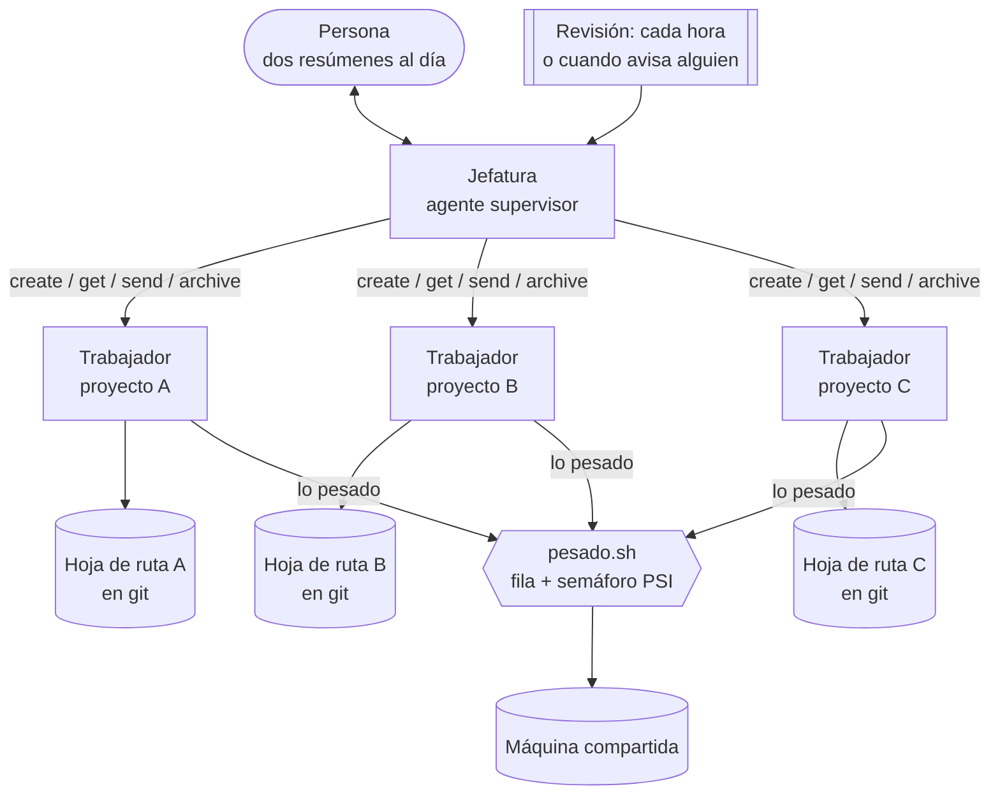

# Equipo de agentes en paralelo

**Cómo trabajo con varios agentes de IA a la vez en una sola máquina: un agente por proyecto, una jefatura que los coordina, relevos por hoja de ruta y una fila común para el trabajo pesado.**

*A small, battle-tested setup for running several coding agents in parallel: one agent per project, a supervisor agent, state handed over through a versioned roadmap, and a shared queue gated by Linux pressure stall information (PSI).*

Con este sistema he llevado en paralelo varios productos completos (una web de juegos diarios en producción, una de calculadoras con miles de páginas y un videojuego), con agentes de Claude Code trabajando día y noche y yo revisando dos veces al día. Aquí está lo que hace falta para que eso no acabe en caos, escrito de forma genérica para reutilizarlo.

## El problema

Un agente de código trabajando solo va bien. Cinco a la vez, no tanto:

- **El contexto se llena** y cada paso cuesta más: un chat de 500.000 tokens gasta en cada paso unas cinco veces lo que uno de 100.000.
- **El estado se pierde** al cambiar de chat, y el agente nuevo vuelve a descubrir lo que ya se sabía.
- **Se quedan parados** sin que nadie se entere: esperando la CI, un límite de uso o una respuesta que nadie va a leer.
- **Se pisan la máquina**: tres navegadores de pruebas, un build y una grabación a la vez la ahogan, y todo va más lento que de uno en uno.

## La solución



| Pieza | Qué hace | Dónde |
|---|---|---|
| **Jefatura** | Un agente que no programa: arranca un trabajador por proyecto, los vigila por la API de sesiones (cada hora, o cuando la persona escribe o un trabajador avisa), los reanuda tras un corte, pide relevos, cierra los que han terminado y resume. Su propio estado también vive en un fichero, así que también se releva. | [`jefatura/PROTOCOLO.md`](jefatura/PROTOCOLO.md), [`jefatura/revision-horaria.md`](jefatura/revision-horaria.md) |
| **Hoja de ruta** | El estado de cada proyecto vive en `docs/HOJA-DE-RUTA.md`, versionado, empezando por «Dónde estamos ahora»: lo terminado, lo que está a medias, el siguiente paso exacto y lo que espera a la persona. | [`plantillas/`](plantillas/) |
| **Relevo** | Al ~30 % de contexto, el agente deja la hoja de ruta al día, la sube y avisa a la jefatura, que lo archiva y arranca uno nuevo con «sigue con <proyecto>». El nuevo arranca leyendo un fichero, no 500.000 tokens de conversación. | [`relevo/SKILL.md`](relevo/SKILL.md) (skill de Claude Code) |
| **Semáforo PSI** | Decide si hay sitio para un trabajo pesado mirando la presión real de CPU, memoria y disco (`/proc/pressure`) y la memoria disponible, no la media de carga. | [`pesado/semaforo.sh`](pesado/semaforo.sh) |
| **Mapa de proyectos** | Un fichero con todos los proyectos (en marcha, parados y los que funcionan solos), lo siguiente de cada uno y lo que espera a la persona, para que ninguno se quede atrás al cerrar chats. | [`plantillas/PROYECTOS.md`](plantillas/PROYECTOS.md) |
| **Plantilla de chats** | Quién es quién entre los chats vivos (sesión, nombre, rol, proyecto, de quién depende), en JSON, para que un panel los pinte sin leer las conversaciones. | [`plantillas/chats.json`](plantillas/chats.json) |
| **Fila de lo pesado** | Navegadores, e2e, builds grandes y grabaciones hacen fila con `flock`, esperan al semáforo y corren con prioridad baja. Varias colas con plazas (CPU y GPU), reentrante y con plazo máximo de espera. | [`pesado/pesado.sh`](pesado/pesado.sh) |

## Decisiones (y el fallo que enseñó cada una)

- **Relevo al 30 %, no al 60 %.** Cada paso reenvía el contexto entero, y la caché del prompt dura una hora: tras una parada larga, reanudar seis chats grandes los reescribe todos de golpe. Medido: un 60 % de la cuota de cinco horas se fue en veinte minutos por eso. Ahora, tras una parada, no se reanuda un chat grande: se abre uno nuevo desde su hoja de ruta.
- **El estado en git, no en el chat.** El chat es desechable; la hoja de ruta no. Si contradice al código, manda el código y se corrige la hoja.
- **Avisar con un mensaje, no en la respuesta.** Un trabajador hizo un relevo perfecto, lo dijo en su respuesta y se quedó parado horas: la jefatura no lee respuestas, lee mensajes.
- **Una tarea programada recurrente, no avisos encadenados.** Un aviso «vuelve en 50 minutos» que cae dentro de un límite de uso no corre ni programa el siguiente, y la cadena se rompe en silencio durante horas.
- **Presión, no media de carga.** La media de carga llegó a marcar 17–23 con la CPU al 5 % de presión: la subían procesos esperando a un disco casi lleno. Con la media como semáforo, los agentes esperaban una CPU que estaba libre.
- **Fila reentrante.** Un despliegue en la fila cuyo build también pedía turno se esperó a sí mismo hora y media con todos los demás detrás. Ahora quien ya tiene turno en una cola pasa.
- **Cola de GPU aparte.** Una grabación con la tarjeta usa un núcleo y la GPU: no tiene por qué esperar a un build que solo usa CPU. Las dos colas respetan el mismo semáforo.
- **Revisión independiente con otro modelo, solo donde equivocarse cuesta caro** (la exactitud de una calculadora fiscal, la seguridad antes de publicar). Un revisor que no escribió el código no comparte sus puntos ciegos; para el día a día, no compensa.
- **Presión de disco también.** Un SSD casi lleno y sin caché propia se quedó al 80 % de ocupación moviendo 9 MB/s: CPU y memoria en verde y todo arrastrándose. El semáforo mira ahora `/proc/pressure/io`, y la jefatura vigila el espacio libre. Las cachés de construcción y las imágenes viejas se comen el disco sin avisar.
- **Esperar sin bloquear.** Un agente que cierra su turno «esperando el build» no vuelve: nadie lo despierta. El build se lanza en segundo plano con un aviso al acabar, y se sigue con otra cosa. Ojo con `until ! pgrep -f "<orden>"`: el propio bucle lleva la orden en su línea, se encuentra a sí mismo y no termina nunca. Quedaron bucles huérfanos días enteros. Mejor esperar con `grep` sobre un fichero de registro.
- **Revisión por eventos.** Cuando la persona prefiere no tener tareas programadas, la jefatura revisa cuando ella escribe o cuando un trabajador avisa con un mensaje. Gasta menos cuota y no se pierde nada, siempre que los trabajadores avisen de verdad.
- **Cerrar lo terminado, nunca lo ajeno.** Cada chat vivo ocupa memoria en la máquina (cerca de medio GB): la jefatura archiva a cada trabajador tras su relevo. Pero nunca los chats que abrió la persona, y «para los chats» significa interrumpirlos, no archivarlos. Un archivado de más no vuelve a arrancar solo.
- **Sesiones fantasma.** Desarchivar una sesión la devuelve a la lista, pero no relanza su proceso: sale como «trabajando» sin nada detrás. Antes de limpiar, inventario: leer el último mensaje de cada una y comprobar que su trabajo está escrito en su proyecto. Así salió algo que se había quedado a medias.
- **Probar por el camino real.** Una entrada que dependía de la IP de origen pasó todas las pruebas lanzadas desde la propia máquina y falló en el primer móvil de verdad, porque la red reescribía el origen. Lo que solo se ve en el dispositivo real se apunta como pendiente de comprobar, no como hecho.
- **Tope de linaje.** Las sesiones que crean sesiones tienen una profundidad máxima. Una jefatura que se releva a sí misma creando la siguiente acaba llegando al tope, y entonces la siguiente la abre la persona a mano. Hay que tenerlo previsto en el protocolo.
- **Lo que no es del agente no se pregunta ni se espera.** Dinero, publicar o cuentas van a «Lo que espera a la persona» y el agente sigue con otra cosa. Así nadie se queda parado esperando un «sí».

## Uso

```bash
# ¿Hay sitio en la máquina?
pesado/semaforo.sh --ver
# VERDE · cpu some 3% (máx. 40), memoria full 0% (máx. 10), disponibles 8100 MB (mín. 1536), disco full 2% (máx. 40)

# Un trabajo pesado, en fila
pesado/pesado.sh web-e2e -- pnpm test:e2e

# Grabaciones con la GPU: cola propia, dos a la vez
pesado/pesado.sh --cola gpu --plazas 2 render-escena-3 -- ./render.sh escena-3

# ¿Quién tiene la fila?
cat "${XDG_RUNTIME_DIR:-/tmp}"/pesado/*.quien
```

Umbrales por entorno: `SEMAFORO_CPU_MAX` (40), `SEMAFORO_MEM_MAX` (10), `SEMAFORO_DISP_MIN` (1536 MB) y `SEMAFORO_IO_MAX` (40; si el núcleo no da `/proc/pressure/io`, no se mira). Necesita Linux con PSI (núcleo 4.20 o posterior), bash y `flock` (util-linux).

Para la parte de agentes: copia [`relevo/SKILL.md`](relevo/SKILL.md) a `~/.claude/skills/relevo/`, pon un `CLAUDE.md` y una hoja de ruta en cada proyecto a partir de [`plantillas/`](plantillas/), y arranca la jefatura con [`jefatura/PROTOCOLO.md`](jefatura/PROTOCOLO.md) y una tarea programada con [`jefatura/revision-horaria.md`](jefatura/revision-horaria.md).

## Pruebas

```bash
bash pesado/probar.sh
```

19 pruebas con un PSI y un `meminfo` falsos (dan lo mismo en cualquier máquina): umbrales del semáforo (CPU, memoria y disco), de uno en uno, plazas en paralelo, colas independientes, reentrada, código de salida, plaza libre si el trabajo muere, rendición tras la espera máxima y arranque al ponerse verde. Comprobadas por mutación: quitar la reentrada, el semáforo, el cerrojo o el código de rendición hace fallar al menos una. La CI pasa ShellCheck y las pruebas en cada push.

## Licencia

[MIT](LICENSE) · Fernando Máximo Martínez García · [fmargar.es](https://fmargar.es)
